<p align="center">
  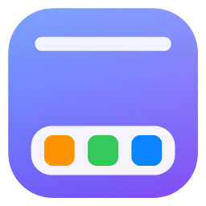
</p>

<h1 align="center">Harbor</h1>

<p align="center">
  A macOS-style dock, menu bar and Control Center for Windows 10 and 11.<br>
  Native, about 20–40 MB of RAM, close to 0% CPU when idle, and starts with Windows.
</p>

<p align="center">
  <a href="https://github.com/hritik-sharmaa/harbor/releases"><b>Download</b></a> ·
  <a href="#features">Features</a> ·
  <a href="#build-from-source">Build</a> ·
  <a href="CHANGELOG.md">Changelog</a>
</p>

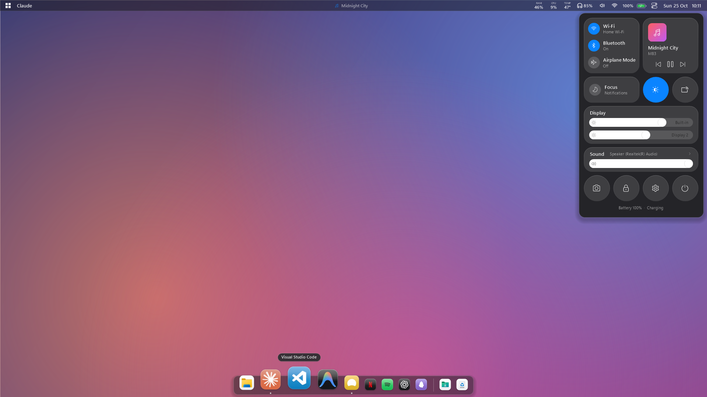

## Why Harbor

Most dock replacements are web apps that run a whole browser in the background. Harbor is plain Win32 and GDI+ code with no Electron, no runtime to install and no polling loops. It reacts to Windows shell events and only animates while something is moving, so it stays out of the way even with many apps open.

## Features

### Dock


- **Looks**
  - Blurred, translucent dock with smooth magnification that follows the cursor
  - Can sit at the **bottom, left or right** of the screen
  - **WhiteSur-style icons** generated from each app's own icon
  - Choose an icon look per app (full colour, brand, white, dark or original), or use any image as a custom icon
- **Apps and windows**
  - Running dots, launch and attention bounce, and **unread badges** (for example "Inbox (3)")
  - **Live window previews** on hover
  - **Minimized windows** and **folder stacks** in the dock. Drag files out of a stack (such as Downloads) straight into a browser upload, chat or folder
  - Web apps and Store apps that run inside a browser (Netflix, installed PWAs) get their own icon instead of the browser's
- **Pinning and editing**
  - Drag to reorder, or drag out to remove
  - Drop a file, folder or `.exe` onto the dock to pin it
  - Right-click for windows, New Window, Keep in Dock, Show in Explorer and Quit
- **Hiding**
  - **Smart Hide** hides the dock only when a window covers it; on the desktop it always shows
  - Hides over fullscreen video and games on each monitor separately, and stays hidden while you take a screenshot

### Menu bar

- **Layout**
  - Full width or "islands" style, on every monitor
  - Can replace the Windows taskbar entirely
- **Left side**
  - The active app's name and its **app menus**
  - **Workspaces** (virtual desktops)
- **Right side**
  - **System tray**, Wi‑Fi, volume and battery
  - **Bluetooth** icon, with **headphone battery** when headphones are connected
  - **CPU, RAM and temperature** readouts, keyboard layout, and **mic and camera in-use dots**
- **Hot corners**, off by default

### Control Center and panels

<p>
  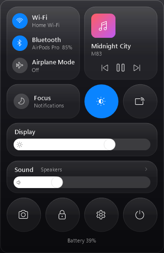
  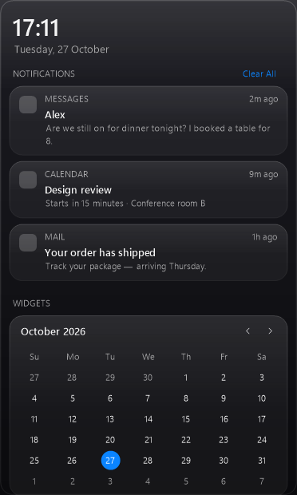
</p>

- **Control Center**
  - Wi‑Fi, Bluetooth and Airplane mode
  - Now Playing, Focus and Dark Mode
  - A **brightness slider for every display**: DDC/CI for external monitors, the laptop panel, or software dimming as a fallback
  - Volume
- **Panels** that open from the menu bar instead of the Windows ones:
  - **Wi‑Fi**: networks list
  - **Bluetooth**: devices with battery levels
  - **Sound**: per-app volume
  - **Calendar** and **Battery**
  - **Now Playing**: colours from the album art, a seekable progress bar, and time-synced lyrics that follow the song (click a line to jump to it)
- **Notification Center** shows your real Windows notifications, plus calendar, now-playing and system widgets
- **Notification banners** appear at the top right in the macOS style instead of Windows' pop-ups. Harbor turns Windows' own banners back on when it quits, and you can switch this off in **Harbor → General**

### The island

Rest the mouse on the centre of the menu bar and a dark panel drops down, like a notch. It never takes keyboard focus from the app you're typing in, and it closes when the mouse moves away.

<p>
  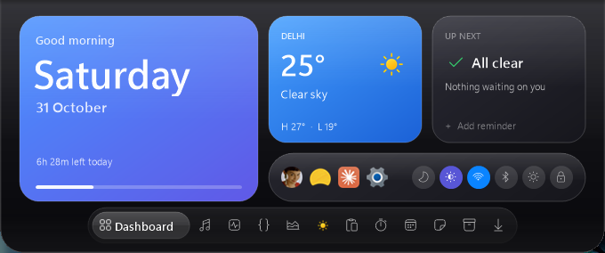
  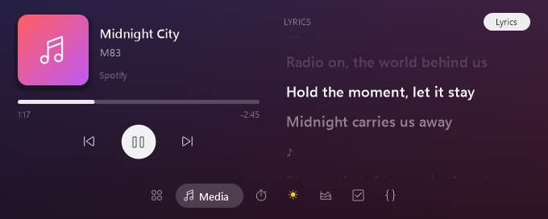
  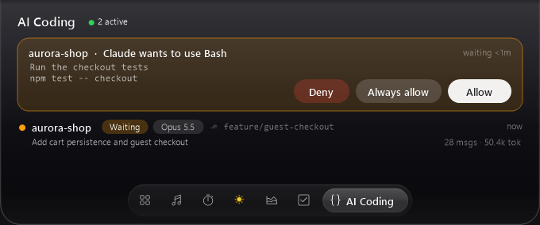
  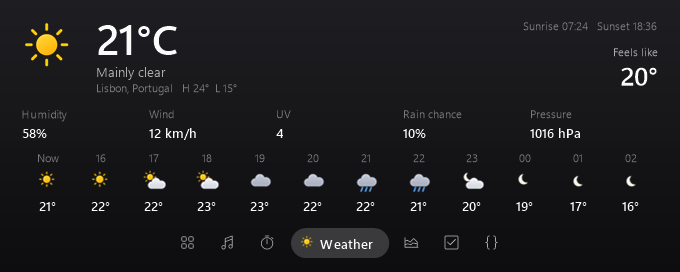
  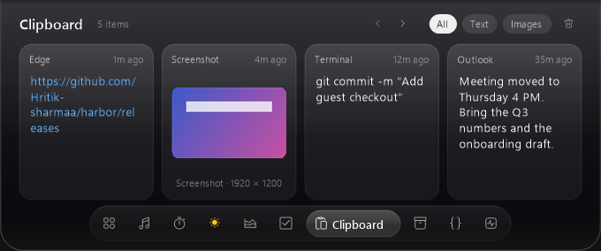
  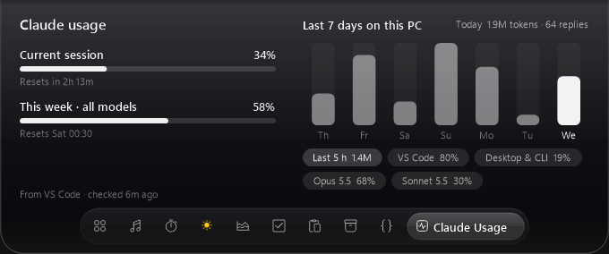
</p>

| Tab | What's in it |
| --- | --- |
| **Dashboard** | Reminders, your most-used apps today, quick toggles (dark mode, Wi‑Fi, Bluetooth, keep awake, screenshot, lock), Pomodoro, day progress and weather |
| **Media** | Cover, seek bar and controls, with synced lyrics beside them |
| **Pomodoro** | Ring timer with Work / Short break / Long break, sessions today, a focus target (one of your reminders) and day progress. While it runs, the time shows in the centre of the menu bar |
| **Weather** | Now, feels-like, humidity, wind, UV, rain chance, pressure and the next 12 hours, from [Open-Meteo](https://open-meteo.com) for the city you set |
| **Screen Time** | Today's time per app and per category, counted and kept on your PC |
| **Reminders** | Quick reminders with optional due times; a banner tells you when one is due |
| **Clipboard** | Your last 30 copies (text, links, images, files) and every new screenshot. Click to copy again, drag images and files out |
| **Shelf** | Drag files onto the centre of the menu bar to keep them here, then drag them out wherever you need them |
| **AI Coding** | Your [Claude Code](https://claude.com/claude-code) sessions with live status (Running / Waiting / Done), model, branch, messages and tokens. When Claude asks permission, the island pops up with **Allow / Always allow / Deny** |
| **Claude Usage** | Your plan limits (session and week) as Claude Code last saved them, plus tokens per day for the last 7 days on this PC, by editor and model |

Set your city, working hours, Pomodoro lengths and the Claude Code link in **Harbor → General → Island**.

**Claude Code approvals** work through a [hook](https://code.claude.com/docs/en/hooks): switching them on adds `Harbor.exe --claude-hook` to `%USERPROFILE%\.claude\settings.json` (backed up first, your other hooks untouched). It applies to Claude Code in the terminal, VS Code and other editors. Whichever answers first wins: the island or the editor's own prompt. If Harbor isn't running or you don't answer, Claude Code simply asks you as usual. Switching it off, or uninstalling Harbor, removes the hook again.

### Customize everything

<p>
  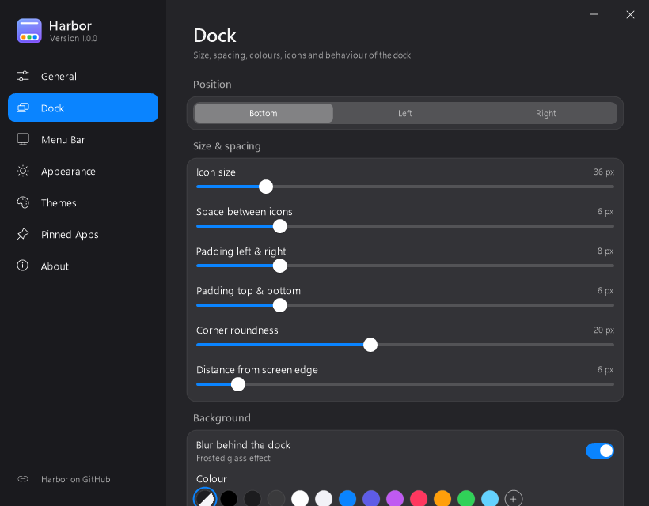
  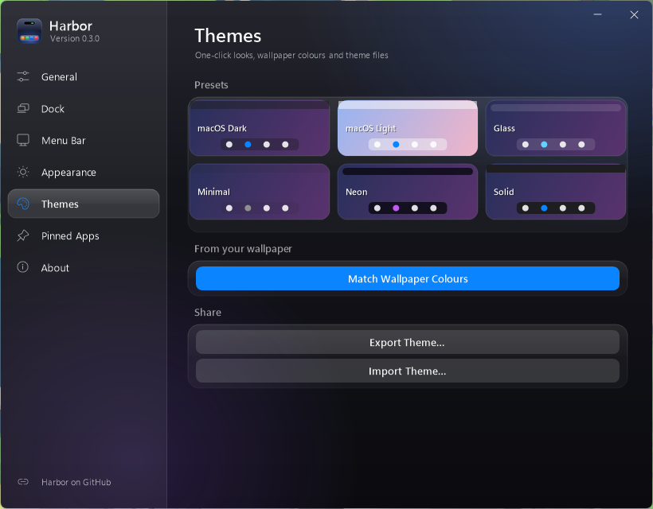
</p>

Open the **Harbor** app from the Start menu. If Harbor is already running, launching it again opens this window.

- **Change live**
  - Sizes, spacing, padding and corner radius
  - Colours, opacity, blur and borders
  - Which items appear in the menu bar
- **Themes**
  - Built-in presets
  - **Match wallpaper colours**
  - Export and import `.harbortheme` files
- **Rules**
  - Hide the dock for specific apps
  - Hide individual apps from the dock
- **Backup**: export and import all settings

### Keyboard shortcuts

| Shortcut | Action |
| --- | --- |
| <kbd>Alt</kbd> + <kbd>Win</kbd> + <kbd>N</kbd> | Notification Center |
| <kbd>Alt</kbd> + <kbd>Win</kbd> + <kbd>C</kbd> | Control Center |
| <kbd>Alt</kbd> + <kbd>Win</kbd> + <kbd>D</kbd> | Toggle dock auto-hide |

You can turn these off in **Harbor → General**.

## Install

1. Download `Harbor-vX.Y.Z.zip` from [Releases](https://github.com/hritik-sharmaa/harbor/releases) and extract it.
2. Double-click **`Install Harbor.cmd`**.

Harbor installs for your user only, without admin rights, into `%LOCALAPPDATA%\Programs\Harbor`. It adds a Start-menu shortcut and an entry in **Apps & features**, then starts automatically at sign-in.

To try it without installing, run `Harbor.exe` straight from the extracted folder.

> **Windows SmartScreen** may warn that the app is from an unknown publisher, because the build isn't code-signed. Click **More info → Run anyway**. You can also [build it yourself](#build-from-source) from the source in this repository.

**Requirements**
- Windows 10 (1903 or later) or Windows 11
- .NET Framework 4.8, which ships with Windows

## Uninstall

Use any of these:
- **Settings → Apps → Installed apps → Harbor → Uninstall**
- **Harbor → About → Uninstall Harbor…**

Quitting or uninstalling always brings the Windows taskbar back. Your settings stay in `%APPDATA%\Harbor` until you delete that folder.

## Build from source

You don't need Visual Studio or any SDK. Harbor builds with the C# compiler that ships with Windows:

```bat
build.cmd
```

That produces `bin\Harbor.exe`. To install your build, run:

```bat
bin\Harbor.exe --install
```

| Command-line flag | What it does |
| --- | --- |
| `--install` | Installs or updates this build for the current user and starts it |
| `--quit` | Closes the running Harbor |
| `--cc` | Opens the Control Center (you can bind this to a key in another tool) |
| `--uninstall` | Removes Harbor |
| `--snapshot <dir> [--demo]` | Renders the UI to PNG files; `--demo` uses sample data. The README screenshots are made this way |
| `--claude-hook` | Used by Claude Code's hook: passes the event to the running Harbor (and, for a permission request, returns your answer) |
| `--lyrics-test <out> <artist> <title> [seconds]`, `--weather-test <out> <city>` | Developer checks: run a lyrics or weather lookup and write the result to a file |

### How it fits together

| File | Responsibility |
| --- | --- |
| `src/App.cs` | Startup, displays, shell events, fullscreen and auto-hide rules |
| `src/Dock.cs`, `src/Previews.cs` | Dock layout, magnification, badges, stacks and DWM window previews |
| `src/TopBar.cs`, `src/TrayService.cs` | Menu bar, app menus, status icons and system tray |
| `src/ControlCenter.cs`, `src/Flyouts.cs`, `src/NotificationCenter.cs` | Panels |
| `src/Flyout.cs` | Small immediate-mode UI toolkit used by every panel and by the Harbor app |
| `src/SettingsWindow.cs`, `src/Look.cs`, `src/Settings.cs` | The Harbor app and `settings.ini` |
| `src/ShellIcons.cs` | Icon loading and the WhiteSur-style icon renderer |
| `src/SystemStatus.cs`, `src/SysInfo.cs`, `src/BtBattery.cs`, `src/WinRT.cs` | Wi‑Fi, audio, brightness, stats, Bluetooth, media and notifications |
| `src/Island.cs`, `src/IslandMore.cs`, `src/NowPlaying.cs` | The island and its tabs; the Now Playing view shared with the media panel |
| `src/ClipboardHistory.cs`, `src/Shelf.cs`, `src/ClaudeUsage.cs` | Clipboard history, the file shelf, Claude usage |
| `src/Pomodoro.cs`, `src/Weather.cs`, `src/ScreenTime.cs`, `src/Reminders.cs` | Pomodoro timer, Open-Meteo weather and icons, Screen Time tracking, reminders |
| `src/ClaudeBridge.cs`, `src/ClaudeHistory.cs` | Claude Code hook, local pipe and settings edit; reading session history |
| `src/Lyrics.cs`, `src/Banners.cs`, `src/ShellDrag.cs` | LRCLIB lyrics, notification banners, dragging files out of stacks |

## Privacy

Harbor has no telemetry, analytics or auto-download. **Check for Updates** just opens the Releases page in your browser.

Harbor only goes online for two things, and only while you're looking at them:

- **Song lyrics:** while Now Playing or the island's Media tab is open, it asks [LRCLIB](https://lrclib.net), a free and open lyrics service, for the current song by sending its title, artist, album and length. Turn this off with the **Lyrics** button or in **Harbor → General**.
- **Weather:** if you set a city, it looks the city up once and then asks [Open-Meteo](https://open-meteo.com) (free, no account) for that city's forecast while the Weather tab or Dashboard is open, at most every 20 minutes. Only the city name and its coordinates are sent.

Everything else stays on your PC:

- Notifications, media info and system stats are read locally to draw the UI and are never stored or sent anywhere.
- **Screen Time** and **Reminders** are saved in `%APPDATA%\Harbor`.
- **Claude Code** events go from the hook to Harbor over a private local pipe, and its session history is read from your own `.claude` folder.
- **Clipboard** history is kept in memory only. Copied images are written to `%LOCALAPPDATA%\Harbor\clipboard` so you can drag them out, and deleted when Harbor quits. Copies that password managers mark as private are skipped.
- **Shelf** saves only the paths of the files you put on it, in `%APPDATA%\Harbor\shelf.txt`.
- **Claude Usage** reads the limits Claude Code saved in its own `.claude.json` and counts tokens from its history files. Your Claude login is never read or used.

## Credits

- Icon style inspired by [WhiteSur](https://github.com/vinceliuice/WhiteSur-icon-theme) by vinceliuice
- Inspired by macOS and [Seelen UI](https://github.com/eythaann/Seelen-UI)

Harbor isn't affiliated with Apple or Microsoft. macOS is a trademark of Apple Inc.

## License

[MIT](LICENSE) © 2026 Hritik Sharma
